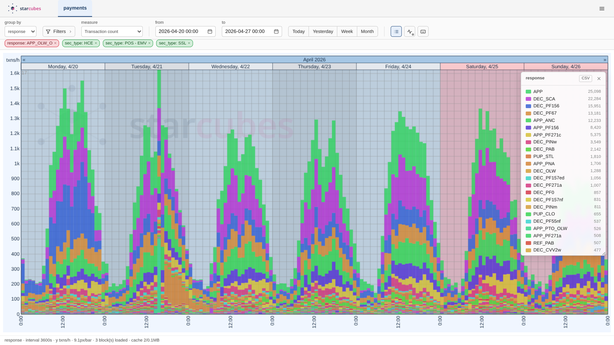
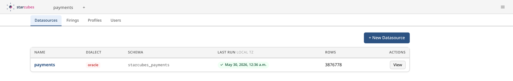
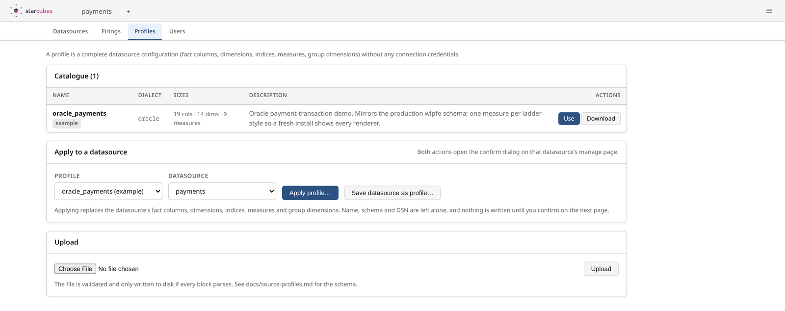
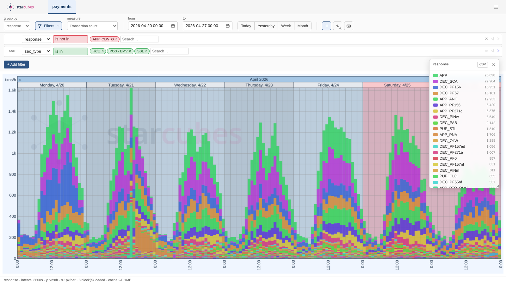
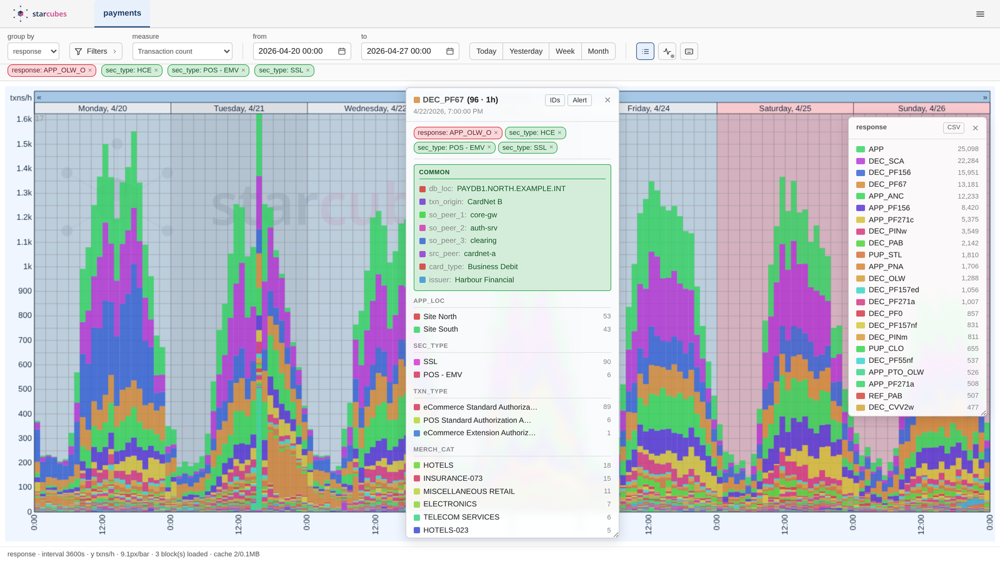
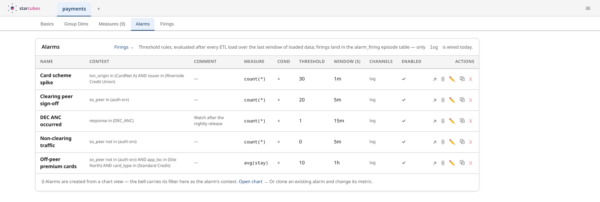
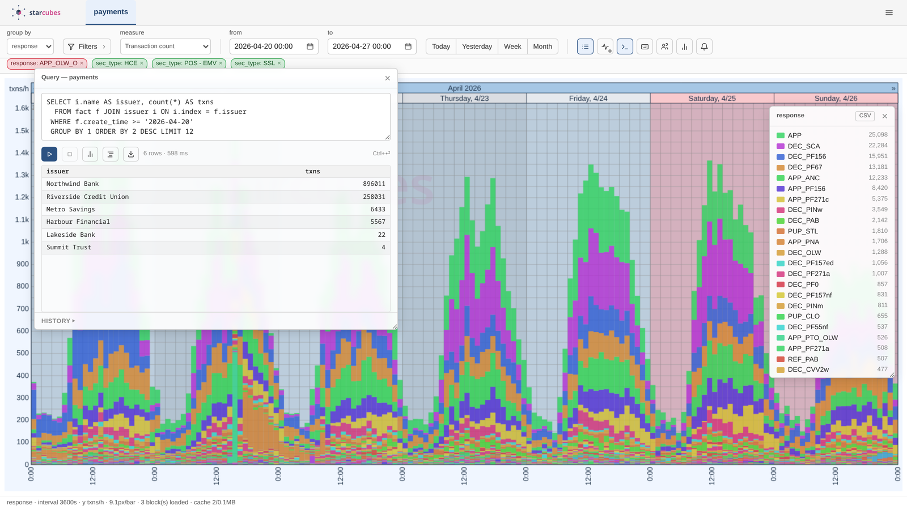
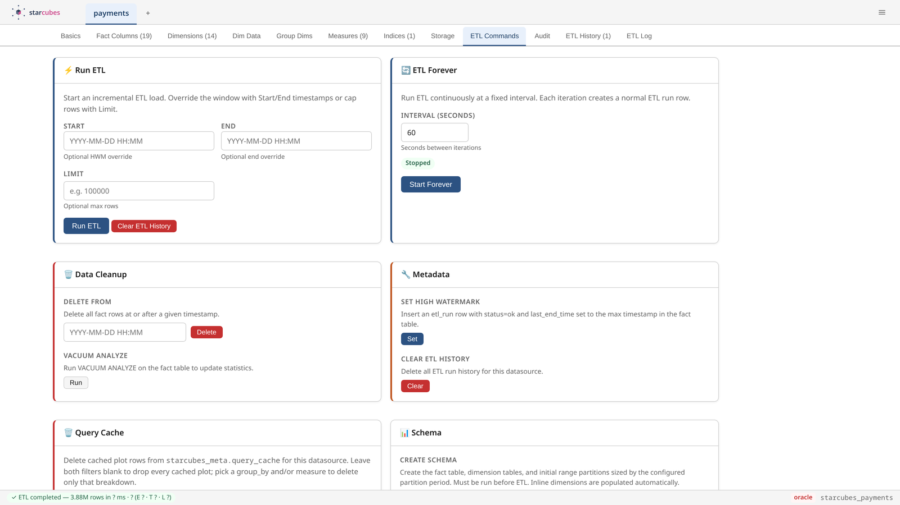
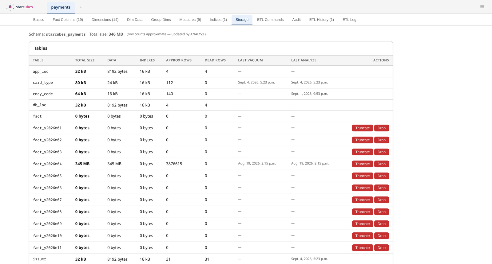

<p align="center">
  <picture>
    <source media="(prefers-color-scheme: dark)" srcset="viz/static/viz/starcubes_lockup_dark.svg">
    
  </picture>
</p>

<p align="center">
  <b>Point starcubes at a SQL database and get a fast, filterable timeseries of
  what happens in it — without modelling a warehouse by hand.</b>
</p>

- **Configure a source in a form, not in dbt.** Base table, watermark column,
  a row per fact column — that is the whole model. Save it as a profile and
  the next install is one click.
- **Built for volume.** The 3.9 million transactions in the screenshots
  below sit in 345 MB: smallint-keyed dimensions, range partitions, BRIN
  on the time column, `COPY FROM` on the load path.
- **One self-hosted container.** No Airbyte, no dbt, no Superset — one image,
  one Postgres, one login.



## What it's for

You have an operational database — payments, orders, requests, events — and
you want to see its shape over time: how many, of what kind, broken down by
whatever dimension you care about right now, over a week or over a year, in
seconds rather than minutes.

Getting there usually means three products. Airbyte or Meltano move the rows,
dbt models the star schema, Superset or Grafana draws the chart — three tools,
three UIs, and the modelling in the middle is still yours to write. starcubes
is the middle. It reads your source on a high watermark, keeps a compact star
schema on Postgres, and serves a stacked-bar timeseries straight off it.

## Five minutes to a chart

```bash
./docker/build.sh                                    # podman by default
podman run -p 8080:8080 \
  -e STARCUBES_POSTGRES_DSN=postgresql://user:pw@host:5432/starcubes \
  starcubes:latest
```

The first boot applies the schema and creates an `admin` / `admin` login —
change it. Then, at `http://localhost:8080/sources/`:

1. **New Datasource** — name, dialect, connection URL.
2. **Apply a profile**, or fill in the base table, watermark column and fact
   columns yourself.
3. **Run ETL**, and open the chart.



A profile is a whole datasource configuration — fact columns, dimensions,
indices, measures, group dimensions — as one YAML file, deliberately without
any credentials. Download one, hand it to a colleague, apply it to a fresh
install.



Prefer the command line? `manage.py seed_example`, `manage.py etl_run`,
`manage.py create_indices` do the same thing — see
[`docs/internals.md`](docs/internals.md#quick-start).

## What it's like to use

### Slice it without writing SQL

Group by any dimension, filter on any other. Filters nest with AND/OR, take
`is in` / `is not in` / `contains` / `starts with`, and live in the URL — so
a view you found is a link you can send.



### Click a bar, see what is in it

Every bar breaks down into its dimensions, and from there into the individual
primary keys behind it. The same panel starts an alarm on exactly the slice
you are looking at.



### Set a threshold on the view you are in

The bell carries the chart's active filter into a new alarm as its context.
Alarms are evaluated by the ETL itself, once after every load, over the
trailing window at the data's own clock — not the wall clock. Breaches are
recorded as episodes with a first-breach and a closed watermark, so a
threshold that flapped for an hour is one row, not sixty.



### Ask the database directly

A read-only SQL console against the datasource's own schema, with a
single-statement guard, a cancel button, per-user history and CSV export.



### Watch the loads

Start an incremental run, override its window, run it forever at an interval,
or kill it. Every run writes a row and its own log file.



And see what it costs you on disk, per table and per partition.



## Features

| | |
|---|---|
| **Ingest** | Oracle, Postgres, MySQL, SQL Server via SQLAlchemy URLs |
| | Incremental loads on a high watermark, resumable, killable |
| | Late-arrival overlap for sources that publish out of order |
| | Auto-dimensions — new values discovered and keyed during the load |
| | Three-stage extract / transform / load with `COPY FROM` |
| **Storage** | One Postgres schema per datasource, star-shaped |
| | Smallint dimension keys, up to 32 767 values per dimension |
| | Day / week / month range partitions, gap-filled automatically |
| | BRIN on the time column; indices built after the first bulk load |
| **Explore** | Stacked-bar timeseries with an interval ladder and follow mode |
| | Nested filters, grouped dimensions, drill-down to primary keys |
| | Quantile bands, error bars, candlesticks for non-count measures |
| | Server-side plot cache for frozen, past-only windows |
| | Read-only SQL console with history and CSV export |
| **Operate** | Threshold alarms with firing episodes, evaluated by the ETL |
| | Gap audit: bucket counts, PK set-diff, and per-id detail |
| | Datasource profiles as portable YAML |
| | Password login, optional Keycloak / OIDC SSO |

## How it works

```
                     starcubes_meta
           (one datasource per row, edited in the GUI)
                             |
                             v
  +----------------+   +-------------------+   +-------------------+
  |   source DB    |   |    core/etl.py    |   |     Postgres      |
  |                |   |                   |   |                   |
  | Oracle / PG    |-->| extract           |-->| starcubes_<name>  |
  | MySQL / MSSQL  |   |   transform       |   |   fact (part.)    |
  |                |   |     load (COPY)   |   |   dim_*           |
  +----------------+   +-------------------+   +-------------------+
                                                        ^
                                                        |
                                             chart / alarms / audit
```

Each datasource gets its own Postgres schema, because two sources rarely have
compatible shapes. The fact table is range-partitioned on its time column and
carries smallint foreign keys into per-dimension tables — which is where the
93 bytes per row come from. Dimensions come in three flavours: imported from a
source lookup table, inlined as CSV in the metadata, or discovered by the ETL
as it goes.

The full picture — pipeline stages, watermark arithmetic, partition
lifecycle, schema decisions — is in [`docs/internals.md`](docs/internals.md).

## Requirements

- **Postgres** for the warehouse.
- **A SQL source**: Oracle, Postgres, MySQL or SQL Server. Oracle is the
  dialect in production use today; the ETL's window literals are still
  Oracle-shaped and need the bind-parameter conversion tracked in
  [`docs/backlog.md`](docs/backlog.md) before another dialect is loaded.
- **Podman or Docker**, or Python 3.12 with `requirements.txt`.

## Documentation

| | |
|---|---|
| [`HOWTO.md`](HOWTO.md) | Driving the GUI, and every configuration field explained |
| [`docs/internals.md`](docs/internals.md) | Architecture, repo layout, CLI quick start |
| [`docs/star-schema.md`](docs/star-schema.md) | Domain vocabulary and schema decisions |
| [`docs/etl-engine.md`](docs/etl-engine.md) | The three-stage pipeline in detail |
| [`docs/etl-audit.md`](docs/etl-audit.md) | The three audit modes |
| [`docs/alarm.md`](docs/alarm.md) | Alarm evaluation and firing episodes |
| [`docs/chart-app.md`](docs/chart-app.md) | The chart UI |
| [`docs/chart-rendering.md`](docs/chart-rendering.md) | Plot types and partial bins |
| [`docs/sources-app.md`](docs/sources-app.md) | The sources GUI |
| [`docs/source-profiles.md`](docs/source-profiles.md) | The profile format |
| [`docs/deployment-config.md`](docs/deployment-config.md) | Container, env vars, SSO |
| [`docs/backlog.md`](docs/backlog.md) | Known unfinished work |

## Acknowledgements

- Chart rendering by [`hgruber/timeseries.js`](https://github.com/hgruber/timeseries.js).

## License

MIT — Copyright © 2026 Worldline. See [`LICENSE`](LICENSE).

starcubes ships one third-party component, `@hgruber/timeseries.js`, which is
MIT — Copyright © 2022–2026 Holger Gruber. Its notice travels with the code:
[`THIRD-PARTY-NOTICES`](THIRD-PARTY-NOTICES) reproduces it in full, and the
container image carries the package's own `LICENSE` next to the bundle.
